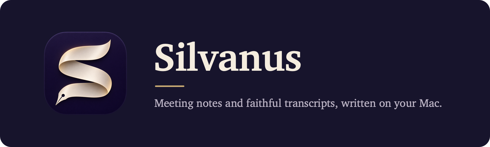
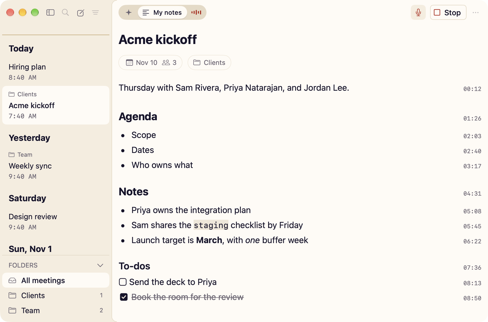
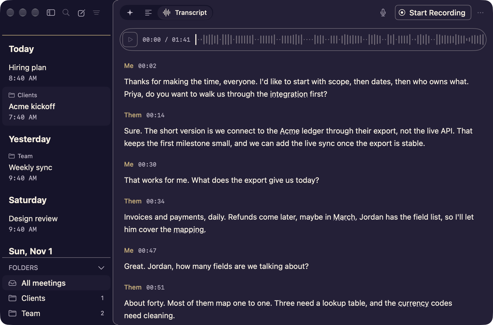

<p align="center">
  
</p>

<p align="center">
  <a href="LICENSE"></a>
  <a href="THIRD-PARTY-NOTICES.md"></a>
  
  
  
  
  
</p>

# Silvanus

I wanted a meeting notes app I could trust with every call: one that records both sides, writes a faithful transcript, and keeps all of it on my Mac as plain files. Silvanus is that app. There's no account, no server, and no bot joining your call.

The name comes from Silvanus, the scribe who wrote down Peter's letter. It also means "of the woods," which suits a guy who likes woodworking.

> **Early preview.** Silvanus records and transcribes real calls today, but it's young. There's no signed download yet, so you build it yourself (it takes about a minute). See [what works today](#what-works-today) before you rely on it.

<p align="center">
  
  
</p>

## What it does

- **Records both sides of a call.** Your microphone and the call's audio go into two separate tracks, so the transcript knows who's you and who's them.
- **Transcribes on your Mac.** Speech recognition runs on the Neural Engine with Parakeet. An hour-long call takes a few minutes, and nothing leaves your machine.
- **Keeps your notes with the moment.** Type Markdown notes during the call; every line gets a quiet timestamp.
- **Plays back from any word.** Click a line in the transcript to hear it.
- **Notices when a call starts and ends.** Silvanus offers to record when a call app starts using the microphone, and it stops on its own when the call is over.
- **Stays out of the way.** A small floating bar shows the recording state, a live level meter, Pause, and Stop.
- **Writes plain files.** Every meeting is a folder of Markdown and JSON you can read, search, back up, or hand to an agent.

## Requirements

- A Mac with Apple silicon
- macOS 26 or later
- Swift 6.2 or later, from Xcode or the Command Line Tools (`xcode-select --install`)
- About 450 MB of disk space for the speech model

## Install

There's no packaged download yet. Build it from source:

```sh
git clone https://github.com/dhanson-wp/silvanus.git
cd silvanus
./build.sh --install
open ~/Applications/Silvanus.app
```

`./build.sh` alone builds a dev copy under `~/Library/Developer/Silvanus` and never touches the installed app. `--install` copies that build to `~/Applications/Silvanus.app`.

### Signing

Without a signing identity, the build is signed ad hoc. That's fine on your own Mac, but macOS ties the microphone and system audio permissions to the signature, so it may ask again after each rebuild. To keep the permissions, create a code signing certificate in Keychain Access and name it in a gitignored `.env.local`:

```sh
SIGN_IDENTITY="Your Certificate Name"
```

## First run

1. **Start a recording.** Click **Start Recording**, or press ⇧⌘R.
2. **Grant two permissions.** Silvanus asks for microphone access (your side of the call) and system audio access (everyone else). It only asks when you first record, never at launch.
3. **Let the speech model download.** The first transcript downloads Parakeet TDT 0.6B v2 (about 450 MB) from Hugging Face. This is the only time Silvanus uses the network. The model is kept in `~/Library/Application Support/FluidAudio/Models`.
4. **Stop, and read.** After you stop, the transcript appears in a few minutes.

Wearing headphones gives the cleanest transcript. Your microphone still hears a little of the other side, faintly through headphones and loudly on speakers; Silvanus silences that before it transcribes your side, but on speakers it won't catch everything.

## Shortcuts

| Action | Shortcut |
| --- | --- |
| Start or stop recording | ⇧⌘R |
| Pause or resume | ⇧⌘P |
| New meeting | ⌘N |
| Quick Note | ⌥⌘N |
| Summary, My notes, Transcript | ⌘1, ⌘2, ⌘3 |
| Show or hide the sidebar | ⌃⌘S |
| Settings | ⌘, |

## Where your meetings live

Everything is under `~/Silvanus/library`, one folder per meeting:

```text
~/Silvanus/library/meetings/<series>/<yyyy-MM-dd HHmm>/
├── meeting.json        title, start and end, attendees, folder, speaker names
├── notes.md            your notes
├── notes-times.json    when each note line was typed
├── transcript.md       the transcript, speaker by speaker
├── transcript.json     every word with its timing and confidence
├── summary.md          a summary, when there is one
└── audio/              the recording, in two 16 kHz tracks
```

These files are the source of truth. There's no database to export from, and deleting the app leaves your meetings where they are. Meetings you delete go to the Trash.

## Privacy

- Audio, notes, and transcripts never leave your Mac.
- There's no account, no analytics, and no telemetry.
- The only network request is the one-time speech model download.

Recording laws differ by place. Tell the people on your call that you're recording, and get their consent where it's required.

## What works today

Working now: recording both tracks, pause and resume, notes with timestamps, after-call transcripts, echo cleanup, playback, folders, call detection, stopping when the call ends, recovery after a crash or a device change, and light and dark mode.

Silvanus can run a local model (Gemma, through llama.cpp) from a file already on your Mac; Settings > Summaries shows which. Not built yet: the to-dos and summaries it will write, search, naming individual speakers, calendar titles, and the agent tools (a command line and an MCP server). The full list, with each story's status, is in [docs/STORIES.md](docs/STORIES.md).

Transcripts are English only for now.

## Development

```sh
./build.sh            # build the dev bundle (add --debug for a debug build)
tools/test.sh         # unit tests
tools/selftest.sh     # the app's real functions, run on a scratch folder
tools/snap.sh         # light and dark snapshots of every screen, in /tmp/Silvanus-shots
```

None of these touch your real meetings, the installed app, or the microphone. The self-test and snapshots refuse to run without a scratch `APP_STORE`.

- `Sources/Silvanus/` is the app: audio capture, the recorder, and the SwiftUI and AppKit screens.
- `Sources/SilvanusKit/` holds the rules and data logic with no UI, and carries the unit tests.
- `Brand/` holds the icon, the menu bar glyph, and the palette. See [Brand/README.md](Brand/README.md).
- `design/KIT.md` is the design kit: every measurement, color, and type role the views read.
- `docs/GLOSSARY.md` lists every word on screen, and `docs/FIXLOG.md` records bugs worth remembering.

It's a Swift package with one dependency. There's no Xcode project.

### For agents

Silvanus is built with coding agents, and the repo is set up for them. Start with [CLAUDE.md](CLAUDE.md): it has the layout, the build and check commands, the design rules, and the rules for keeping this public repo clean. A change is done when the build has no warnings from our code, the tests and self-test pass, and you've looked at the light and dark snapshots.

A few switches on the dev binary help with headless work (always with `APP_STORE` set to a scratch folder):

| Variable | What it does |
| --- | --- |
| `APP_STORE=<folder>` | Uses that folder as the library instead of `~/Silvanus/library` |
| `APP_TRANSCRIBE_FILE=<audio file>` | Prints one file's words with their times |
| `APP_TRANSCRIBE=<meeting id>` | Runs the after-call pass on that meeting's `audio/` folder |
| `APP_SELFTEST_AUDIO=1` | Adds a real transcription pass to `tools/selftest.sh` |

Meetings are plain files, so an agent can read them straight from the library folder today.

## Contributing

Issues and pull requests are welcome, especially reports from real calls: what you recorded with, what the transcript got wrong, and what you expected.

This repo is public, so it never holds meeting data, real people's names, or secrets. Run `tools/install-hooks.sh` once after cloning; it installs a pre-commit check that enforces this. Examples and tests use made-up meetings and people.

## Credits

Silvanus stands on other people's work, and I'm grateful for it:

- [FluidAudio](https://github.com/FluidInference/FluidAudio) by FluidInference runs speech recognition on the Neural Engine (Apache 2.0).
- [Parakeet TDT 0.6B v2](https://huggingface.co/nvidia/parakeet-tdt-0.6b-v2) by NVIDIA is the speech model, in the [Core ML conversion](https://huggingface.co/FluidInference/parakeet-tdt-0.6b-v2-coreml) by FluidInference (CC BY 4.0).
- [OpenOats](https://github.com/yazinsai/OpenOats) and its contributors showed the way on system audio capture; that part of Silvanus is adapted from it (MIT).

The full license texts are in [THIRD-PARTY-NOTICES.md](THIRD-PARTY-NOTICES.md).

## License

Silvanus is released under the [MIT License](LICENSE). Copyright (c) 2026 Derek Hanson.
